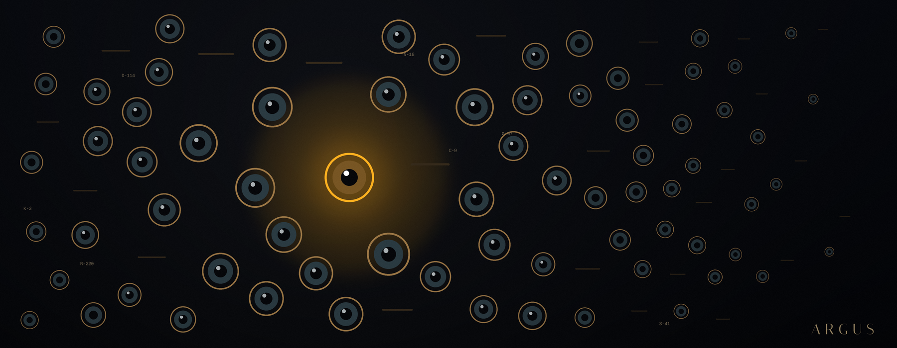
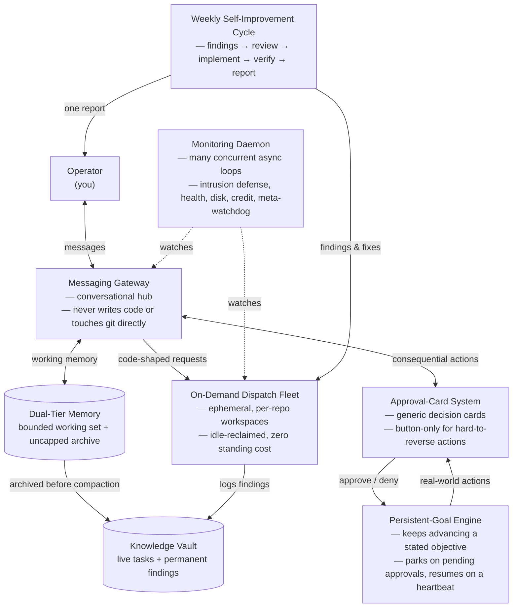

# Argus

**A reference architecture for a self-hosted, always-on autonomous agent fleet — the pattern behind a system that out-covers Meta's Muse, xAI's Grok Bot, and OpenAI's Dots at a fraction of the price, by owning the infrastructure instead of renting access to someone else's.**

---

## What this is

Argus is not a product, a library, or a service. It is a **written-down architecture pattern** — the design of a production fleet that has been running for months, generalized so anyone technical enough to run their own VPS can rebuild it for themselves, without copying a single real credential, hostname, or account ID from the system it was extracted from.

The fleet this pattern comes from runs, concurrently and unattended:

- A messaging-gateway bot that interviews you conversationally and routes anything code-shaped to a separate execution layer it never touches itself.
- An on-demand fleet of coding agents that spin up, do the work, commit, and tear themselves down — zero idle cost when nothing is happening.
- A consolidated monitoring daemon watching intrusion attempts, dispatch health, disk pressure, and its own sub-loops, all at once, in one process.
- A weekly, fully autonomous self-improvement cycle that audits its own security posture and efficiency, decides what to fix, fixes it, and verifies the fix — reporting the outcome rather than asking permission.
- A persistent-goal engine that keeps working on a stated objective across hours or days without being re-prompted, with real-world consequential actions (sending email, booking something, spending money) gated behind an explicit approval card rather than left to run blind.
- An optional real-money financial-automation module, generalized as a pattern for *any* domain where an agent needs to take real-world, hard-to-reverse actions safely.

None of this is hypothetical. All of it is described in [`docs/architecture.md`](docs/architecture.md) as a pattern, with every identifying detail — names, hosts, IDs, IPs — replaced by a placeholder.

## Why "Argus"?

In Greek myth, Argus Panoptes was the hundred-eyed giant set to watch over Io — his eyes never all closed at once, so nothing could slip past him unseen. That's a literal description of this architecture's defining property: no single clever agent is doing the watching. Dozens of narrow, boring, independent loops run concurrently — intrusion defense, dispatch-health checks, disk-pressure thresholds, credit-anomaly detection, an external dead-man's-switch heartbeat, a meta-watchdog that restarts anything that silently stalls, and a weekly pass that audits the system's own security posture and efficiency. None of them is individually impressive. Together, they're why "fully autonomous for the right scope" is survivable here rather than reckless — there is always an eye open, even when the operator is asleep and the primary agent is mid-task. The name also continues this architecture's own convention of naming each component after a figure whose myth matches its job, rather than a generic product label.

## Start here

**You do not read this repo top to bottom and start copying files.** There are no files to copy — this is documentation-only, by design. Instead:

1. Open [`docs/interview.md`](docs/interview.md).
2. Hand it to whatever agentic coding CLI you already have (Claude Code, Antigravity, Cursor, or anything else capable of reading a long instruction document and asking you questions).
3. Let it interview you — eight phases, one at a time — about your budget, your platform choices, which modules you actually want, and how autonomous you want each one to be.
4. It ends with a confirmed profile summary. From there, *you and your CLI* design and build your own instance — this repo gave you the pattern and the questions, not the code.

## Architecture at a glance

## Table of contents

| Document | What it covers |
|---|---|
| [`docs/architecture.md`](docs/architecture.md) | The complete, comprehensive architecture — every component, as one integrated reference, not a checklist of optional add-ons. |
| [`docs/interview.md`](docs/interview.md) | The eight-phase interview your coding CLI runs against you before building anything. |
| [`docs/budget.md`](docs/budget.md) | What this costs to run, minimum and recommended, with the gateway's own model cost broken out as its own line — compared against sourced pricing for Muse, Grok Bot, Dots, and Cursor Ultra. |
| [`docs/comparison.md`](docs/comparison.md) | An honest capability comparison against consumer always-on agent products — including where they beat this architecture outright. |
| [`CONTRIBUTING.md`](CONTRIBUTING.md) | How to propose changes to the pattern itself. |
| [`REDACTION_CHECKLIST.md`](REDACTION_CHECKLIST.md) | What must never appear in this repo, for anyone adding to it later. |

## What this is not

- Not a turnkey product. There is no installer, no `docker run`, no SaaS signup.
- Not a code drop. Every example in this repo is a placeholder pattern, not a working script — your coding CLI writes the real implementation, scoped to your own choices.
- Not a claim that this beats every consumer agent product on every axis. [`docs/comparison.md`](docs/comparison.md) is explicit about where the zero-setup consumer products win.

## License

[MIT](LICENSE) — fork it, adapt it, build on it.
