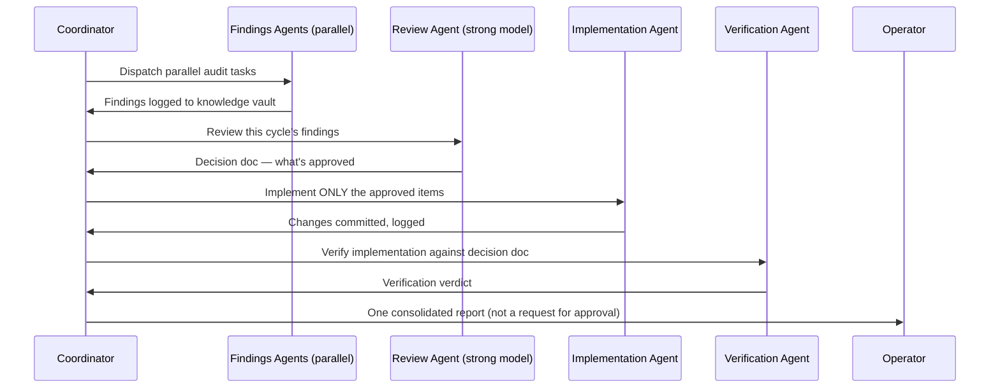

# Argus — Comprehensive Architecture

This is a single, comprehensive description of the fleet pattern — every component that actually runs in production, together, as one integrated system. There is no "core" tier and "optional module" tier here; the self-improvement cycle and the goal-carrying/life-admin layer are as load-bearing to this architecture's value proposition as the dispatch fleet itself, so they're described in-line with everything else, not relegated to an appendix.

Every name, host, ID, and credential below is a placeholder pattern. Nowhere in this document is a real value from the system it was generalized from.

## Table of contents

1. [The gateway/dispatch split](#1-the-gatewaydispatch-split)
2. [On-demand ephemeral dispatch fleet](#2-on-demand-ephemeral-dispatch-fleet)
3. [The monitoring daemon](#3-the-monitoring-daemon)
4. [The approval-card system](#4-the-approval-card-system)
5. [Dual-tier memory](#5-dual-tier-memory)
6. [Knowledge-vault integration](#6-knowledge-vault-integration)
7. [The file-sync rule](#7-the-file-sync-rule)
8. [Scheduled digests](#8-scheduled-digests)
9. [Multi-repo git hygiene](#9-multi-repo-git-hygiene)
10. [The vendor-checkout rule](#10-the-vendor-checkout-rule)
11. [The gateway's own model-aggregator pattern](#11-the-gateways-own-model-aggregator-pattern)
12. [The weekly self-improvement cycle](#12-the-weekly-self-improvement-cycle)
13. [Persistent goal-carrying and life-admin autonomy](#13-persistent-goal-carrying-and-life-admin-autonomy)
14. [The financial-automation pattern (generalized)](#14-the-financial-automation-pattern-generalized)

---

## 1. The gateway/dispatch split

A single messaging-gateway bot is the one surface the operator talks to — over whatever messaging platform(s) they choose. It runs as a persistent service, handling conversational and informational queries directly.

The hard architectural boundary: **the gateway never writes code, never touches git, and never runs engineering commands itself.** When an incoming request is code-shaped — a bug fix, a script, a git operation, a security audit — it is intercepted *before* the gateway's own language model ever reasons about it, via a deterministic pre-processing hook that recognizes the request's shape and routes it to the dispatch fleet instead. This is zero-judgment routing on purpose: a model deciding case-by-case whether something "counts" as code is a much weaker guarantee than a hook that simply never lets code-shaped text reach the model's own tool-calling surface in the first place.

Why this boundary exists: a conversational gateway accumulates an enormous amount of unrelated context over a long-running session — personal notes, scheduling, casual conversation. Letting that same context-heavy session also write and commit code means every commit carries the full weight of an unrelated conversation history, and a single compromised or confused gateway session could touch source control directly. Splitting the two means the dispatch fleet's sessions start clean, scoped to one repository, with no memory of anything else.

## 2. On-demand ephemeral dispatch fleet

Rather than a standing army of always-on worker processes, coding and audit tasks spin up a **fresh, isolated workspace per repository, on demand.** A workspace is named by a convention like `repo-<project-name>`, lives at that repository's actual filesystem root, and is torn down automatically once idle past a threshold (on the order of 30 minutes) — with hard guards: never reclaim a workspace with uncommitted changes, never reclaim one holding an active dispatch lock.

Within a workspace, different roles run on different underlying agentic CLIs and model tiers, selected by a routing table that maps a profile name to `{CLI kind, model, effort level}` — e.g. a "rigorous review" profile bound to a strong reasoning model for security-critical audits, escalating further for incident-shaped findings; a "build" profile bound to a faster, cheaper model for routine implementation; a "deep" profile for cross-cutting architectural work. Profile selection can be inferred from the task's own text, but for anything safety-critical, an **explicit override** should always be available rather than relying purely on keyword inference — a routing mistake that silently lands a security review on the wrong model tier is exactly the kind of failure that's invisible until it matters.

Result: zero idle compute cost when nothing is happening, full repository context with no cross-task contamination, and no single long-lived process that accumulates drift over weeks.

## 3. The monitoring daemon

One consolidated process runs many concurrent async loops at different cadences (seconds to tens of minutes) rather than a sprawl of separate watcher scripts. Representative loops:

- **Intrusion defense** — fail-closed behavior on unrecognized access attempts, checked on a short cadence (seconds), because a defense that *should* trigger automatically but silently never fires is worse than no defense at all; this needs its own liveness check, not just an "it's configured" assumption.
- **Dispatch-fleet liveness** — detect a crashed or hung ephemeral workspace and either relaunch or surface it, scoped carefully so a single-workspace crash never gets misread as "the whole fleet is down."
- **Cron-failure surfacing** — a failed scheduled job becomes an interactive notification, not a silent gap in a log file nobody reads.
- **Disk hygiene, tiered.** Three deliberately layered response tiers to the same underlying cleanup action: an early threshold sends an interactive "want me to clean this up?" card and waits; a higher, more urgent threshold runs the cleanup autonomously with no confirmation; and an on-demand authenticated control endpoint lets the operator (or another script) trigger it regardless of current usage. This is intentional layered coverage, not duplicated logic — alert-and-wait, autonomous-critical, and manual-anytime are three different situations.
- **Spend/credit anomaly monitoring** — watching for unexpected usage spikes against whatever metered services the fleet depends on.
- **An external dead-man's-switch heartbeat** — a ping to a service outside this VPS entirely, so a total process kill (not just a crash the daemon can catch on its own) is still detected.
- **A meta-watchdog** — a loop whose only job is noticing if any *other* loop has gone silently stalled (no tick within roughly 3x its expected interval) and hard-exiting the whole daemon so a process supervisor restarts it clean. Monitoring the monitor is not optional once you have more than a couple of loops.

## 4. The approval-card system

For any consequential action — one that's expensive, hard to reverse, or affects something outside the system's own sandbox — the system sends an interactive decision card to the operator's messaging app rather than acting blind or simply asking in plain text.

The core mechanism is deliberately generic: a card-creation function takes a subsystem label, a title, a list of options, and a free-form context payload — it has no idea what domain it's being used for. A callback handler resolves which button was tapped and dispatches to domain-specific logic layered on top. Because the core is generic, extending this to a brand-new domain (say, approving an email send, where the original system was built for approving disk cleanup) requires no change to the card-creation or callback-dispatch mechanics — only a new piece of "what to actually do when approved" logic for that domain.

A narrower, lower-friction path exists for genuinely low-risk, easily-reversible actions: a **text-reply shortcut**, where a short keyword reply to a *fresh* pending card (matched against an explicit allowlist of safe subsystems) resolves it without needing to tap a button. This is deliberately **never** extended to anything cost-shaped, financial, or otherwise hard to reverse — those stay button-only, permanently, even if it would be convenient to allow a quick text reply. The asymmetry is the point: convenience shortcuts are earned by the action being safe, not by the action being common.

## 5. Dual-tier memory

A gateway bot's live context window is bounded — it has to be, both for cost and for prompt-cache efficiency. But a bounded context means old facts and preferences get silently dropped once the window fills and compacts, unless something captures them first.

The pattern: a small, fast "working memory" (character-capped, optimized for being read on every turn) is periodically — on the order of every 30 minutes, and again on a daily cycle — extracted into a second, **uncapped, version-controlled permanent archive**, *before* any compaction of the working tier is allowed to proceed. The archive is structured as an append-only cumulative ledger plus daily consolidated snapshots, so nothing is ever silently lost even though the live window stays small. A pre-compaction safety guard explicitly forces this extraction to run first, rather than trusting a time-based schedule to always have already caught up.

## 6. Knowledge-vault integration

A lightweight, structured place to record two different things: a **live task board** (what's currently being worked on, auto-created when a task is dispatched, auto-closed when it completes) and a **permanent findings vault** (architecture decisions, audit results, bug resolutions — a durable record independent of any live task's lifecycle).

Both are driven through one small, reusable command-line wrapper around whatever knowledge-management tool's API is in use, rather than scattering ad hoc API calls across the codebase — every script that needs to log a finding or update a task shells out to the same wrapper, so the integration logic exists in exactly one place.

## 7. The file-sync rule

A simple, strictly enforced division: **anything that's code goes to version control. Anything that's not goes to a synced file store** (a cloud-storage mount, two-way synced on a short interval, organized by a simple category scheme like Projects/Areas/Resources/Archives). Documents, datasets, research material, and media never live as loose files sitting in a code repository, and code never gets treated as "just another document" dropped into the file-sync store. The rule is boring on purpose — the moment this gets blurry, both stores become unreliable.

## 8. Scheduled digests

A handful of independent, cron-driven scripts that each do one thing: fetch some information, render it into a readable card, send it to the operator, exit. No shared state between them, no ongoing session — each run is a fresh, isolated, fetch-render-send-exit cycle. This simplicity is deliberate: a digest script that fails doesn't take down anything else, and there's no accumulated state to debug when something goes wrong.

## 9. Multi-repo git hygiene

In a fleet managing several independent repositories, two rules prevent a large class of avoidable mistakes: every git command is scoped to the correct repository root for the files actually being touched (never run from a location that isn't unambiguously inside exactly one repository), and staging is always deliberate — never a blanket "add everything," since another process might have unrelated in-progress changes sitting in the same working tree.

A further refinement worth adopting: for files flagged as security-sensitive, a commit-time hook can require an **explicit interactive approval round-trip** before the commit is even allowed to complete — the hook blocks the commit, sends a decision card, and only accepts the commit once an approval produces a one-time token that must appear as a trailer in the commit message. This turns "did a human actually look at this" from a social convention into something mechanically enforced.

## 10. The vendor-checkout rule

Any third-party tool's own upstream-maintained code should never be hand-edited in place. If a local fix is genuinely needed, it either gets contributed upstream, or it gets tracked as an explicit, clearly-labeled "reapply after the next update" patch living *outside* the vendor's own directory — never left as uncommitted drift inside code that an update process will overwrite or conflict with. Skipping this rule is how a fleet quietly accumulates months of unreconciled hand-edits that turn every subsequent update into a merge-conflict minefield.

## 11. The gateway's own model-aggregator pattern

This is its own architectural decision, separate from everything about the dispatch fleet's model choices (§2): **what model powers the gateway's own day-to-day conversational layer is a distinct cost and capability axis from what models the dispatch-fleet workers use.** Conflating the two — assuming "the LLM" is one line item — hides a real design decision.

The pattern: source the gateway's conversational model through a model-aggregator service rather than binding directly to one vendor's API, so the model can be swapped without re-architecting anything else. On top of that, maintain an explicit, ordered **fallback chain** across providers — ordered so the cheapest reliable tier is tried first — with per-(credential, model) circuit breakers: once a specific model on a specific credential is confirmed exhausted (not just slow), fail fast rather than retrying into a multi-second stall that blocks every other request behind it. And critically: **never let the system silently substitute a different, unrequested model** as a side effect of a retry or fallback — any provider or model swap should be a decision the fallback chain explicitly declares, not something inferred quietly inside a retry loop. A silent substitution is exactly the kind of thing that looks fine in testing and then surprises you in production usage patterns nobody tested.

## 12. The weekly self-improvement cycle

A recurring, fully autonomous, multi-stage pipeline scoped specifically to the system's **own infrastructure and security posture** — never extended to application code without a separate, deliberate decision to widen its scope.

Five stages, run as one coordinated cycle on a weekly cadence:

1. **Findings** — multiple independent audit tasks run in parallel (on isolated workspaces, so they don't serialize behind each other), each logging what it finds to the permanent knowledge vault, tagged with a shared cycle identifier. No files are edited in this stage — findings only.
2. **Review** — a single pass by a strong reasoning-tier model reads everything the findings stage logged for this cycle and decides which findings genuinely warrant a change, writing a decision document.
3. **Implementation** — a single pass implements *only* what the review stage approved, following the same git-hygiene rules (§9) as any other change, and logs what it actually did.
4. **Verification** — an independent pass (deliberately a different model tier than the implementation stage, to avoid the same blind spot reviewing itself) checks the actual change against the decision document and confirms system health afterward.
5. **Report** — exactly one consolidated message to the operator, covering what was found, what was approved, what was implemented, and the verification verdict. This is explicitly a **report, not a request for approval** — the autonomy decision was made once, upfront, in scoping this cycle to infra/security only, not re-litigated every week.

The reason this scope restriction matters: git-versioned infrastructure changes are revertible. A bad change can be rolled back from history. This is precisely why full autonomy is defensible *here* and not automatically extended to domains where an action, once taken, can't be undone the same way (§13, §14).

## 13. Persistent goal-carrying and life-admin autonomy

The single capability most associated with "always-on agent" products: a stated goal keeps advancing across hours or days without the operator re-prompting at each step.

**The core insight, worth stating plainly: this often does not need to be built from scratch.** Check whether the agentic platform you're already running has a native persistent-session-goal primitive before reaching for a bespoke polling loop — a goal object that persists across restarts, with an automatic judge that re-prompts the session itself after each turn until the goal is satisfied or a turn ceiling is hit. If a mechanism like this already exists, the real work is usually *wiring and completion*, not construction: making sure something actually resumes a dormant goal after your gateway's own scheduled restarts (a lightweight periodic heartbeat that checks for any active-but-dormant goal and nudges it forward is usually sufficient — far simpler than reinventing the persistence layer).

Layered on top of goal-carrying, for any domain involving real-world actions (sending a message, managing a calendar, browsing and acting on a website):

- **Connectors for the actual actions** — email send/reply, calendar management, file storage, and genuine browser automation (the ability to navigate, click, and type, not just search and read) are table stakes for this capability to mean anything.
- **A generalized approval gate specifically for consequential calls.** A hook that intercepts specific tool calls matching a policy — sending to an unrecognized recipient, a calendar invite with external attendees, anything that looks like it's about to submit a payment or booking — and redirects them through the approval-card system (§4) instead of letting them proceed.
- **The goal "parks," it does not fail, while waiting on an approval.** This is the detail that makes the whole thing usable: a goal blocked on a pending decision should cost nothing (no wasted model calls while waiting) and should never be marked abandoned or retried destructively — it should simply resume, cleanly, the moment the approval resolves, with the same heartbeat mechanism that handles restart-recovery also serving as the fallback if the immediate resume signal is ever missed.
- **A simple, explicit policy — not a learned classifier — decides auto-OK versus always-gated.** Read-only actions and drafts that aren't sent are safe to auto-approve; anything with a cost, payment, or booking shape, or any communication to an unrecognized party, is always gated, full stop. And the approval card itself must show the **literal values** about to be submitted — the actual recipient, the actual amount, the actual flight details — not a generic "approve this action" prompt, because a misread field in the underlying action is otherwise invisible to the approver even though they technically "approved" something.

## 14. The financial-automation pattern (generalized)

Although the concrete example this pattern comes from is a trading integration, nothing about it is specific to finance — it's a general template for **any domain where an autonomous system takes real-world, hard-to-reverse actions with a resource that can run out.**

- **Budget-cycle accounting with carry-forward, capped.** A spending (or more generally, resource-consumption) allowance that resets on a cycle, with unused allowance carried into the next cycle up to an explicit cap — so a quiet period doesn't just evaporate the allowance, but also can't compound indefinitely into an unbounded reserve.
- **Layered invariants, checked on every single action, no exceptions — including dry runs.** Hard rules like "never touch this specific protected resource," a ceiling on any single batch of actions *and* a separate ceiling on total actions per day (independent of the cycle-level cap — a fast-moving burst and a slow cycle-level drain are different failure modes and deserve different limits), and an explicit restriction on the *kind* of action the system is allowed to take at all (e.g. structurally incapable of the destructive half of a reversible pair of actions).
- **An instant, independent kill switch.** A single command that blocks every automated action immediately, checked before any other rule, with no dependency on cron timing or a code deploy to take effect. If you only remember one piece of this pattern, remember this one — a kill switch that depends on anything else working correctly is not actually a kill switch.
- **An authoritative reconciliation record, trusted over the system's own bookkeeping.** A periodic, independent snapshot of what *actually* happened (the real state of the external resource, not the automation's internal log of what it believes it did) is what every budget calculation should be checked against — if you ever need to answer "how much has actually happened," trust the independent record, never the self-reported one.
